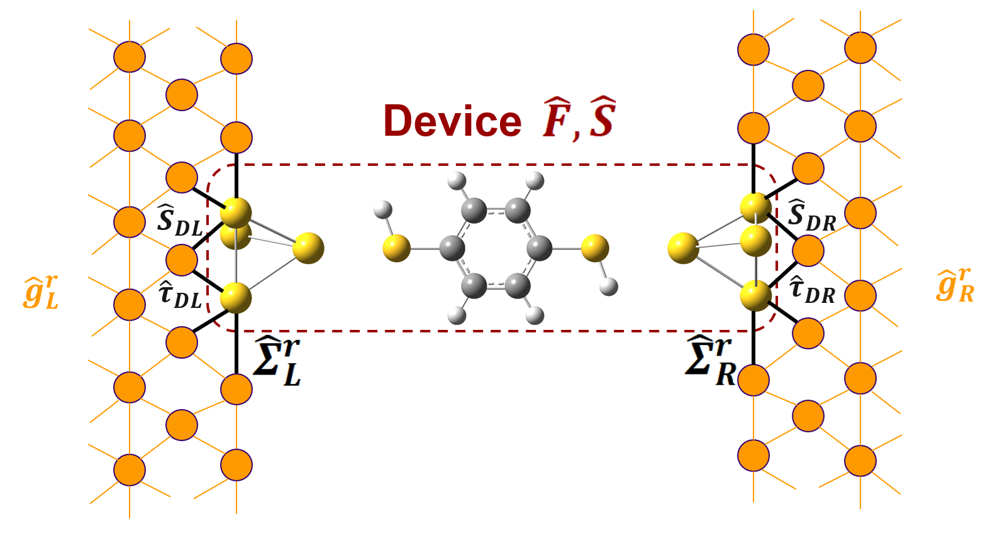

# GauNEGF

[](https://doi.org/10.5281/zenodo.15178667)
[](https://opensource.org/licenses/MIT)



*The device region (dashed box) holds the molecule plus the gold atoms
attached to it; Gaussian supplies its Fock matrix F and overlap matrix S.
Each side couples to a semi-infinite Bethe-lattice contact with surface
Green's function g^r_L or g^r_R, through the hoppings tau_DL / tau_DR and
the overlaps S_DL / S_DR; together these give the contact self-energies
Sigma^r_L and Sigma^r_R. gauNEGF keeps the device-contact overlap exactly
(non-orthogonal), including its cross term in the electron count.*

***Note: This package uses the Gaussian Development Version and the Gaussian
Python interface (gauopen), which are not publicly available. Please check the
[Gaussian website](https://gaussian.com/news/) for updates on the forthcoming
releases.***

Documentation: [https://wliverno.github.io/GauNEGF/](https://wliverno.github.io/GauNEGF/)

## What gauNEGF is

gauNEGF is a Python package for Non-Equilibrium Green's Function (NEGF)
quantum transport calculations self-consistently coupled to density
functional theory in Gaussian. A device (molecule plus attached contact atoms)
is computed in Gaussian; gauNEGF attaches semi-infinite contacts through their
self-energies, builds the NEGF density matrix, hands it back to Gaussian for a
new Fock matrix, and iterates to self-consistency. The converged Fock matrix
then gives transmission, density of states and current.

gauNEGF builds on the open-source ANT.Gaussian package; the methods it draws
on and their references are listed in the
[theory introduction](https://wliverno.github.io/GauNEGF/theory/introduction.html).

Note: This package requires a licensed copy of Gaussian quantum chemistry
software to run. Gaussian is a registered trademark of Gaussian, Inc.

## Features

- **Two SCF drivers.** `gauNEGF.scf.NEGF` uses constant (energy-independent)
  self-energies and integrates the density analytically; `gauNEGF.scfE.NEGFE`
  uses energy-dependent contact self-energies and integrates the density on a
  complex contour (plus a real-axis bias window under bias), at zero or finite
  temperature.
- **Contact models.** Constant self-energy (`setSigma`); semi-infinite 1D
  chains (`setContact1D`, contact blocks extracted from the device Fock or
  given explicitly); Bethe lattices for FCC metals (`setContactBethe`, with
  `Au.bethe`, `Au2.bethe` and `AuSOC.bethe` parameter files). A per-atom 3D
  contact builder (`surfG3D.surfGAt3D`) is also included; the full 3D-periodic
  wrapper (`surfG3`) is not yet validated end to end. See
  [Supported configurations](https://wliverno.github.io/GauNEGF/supported_configurations.html) for the tested / limited / untested status
  of each.
- **Non-orthogonal contacts.** The device-contact overlap enters the
  self-energy, the density, the DOS and the electron count, including the
  device-contact cross term, at equilibrium and in the bias window.
- **Fermi energy.** Pinned (`setVoltage(qV, fermi)`) or searched every SCF
  cycle (`setVoltage(qV)`). `NEGF` bisects the analytic electron count;
  `NEGFE` offers Muller, secant, polynomial-fit, bisection and
  constant-self-energy prediction methods (`fermiMethod`), and `fermiCount`
  chooses which electrons its search makes neutral.
- **Spin.** Restricted, unrestricted, restricted open-shell and generalized
  (non-collinear) spin (`spin='r'/'u'/'ro'/'g'`); spin-orbit coupling in the
  Bethe-lattice contacts (`AuSOC`).
- **Transport.** `transport.calculate_transmission`, `calculate_dos` and
  `calculate_current`, with checkpoint/resume of long energy scans and
  spin-resolved channels; for spin-resolved runs the total is the exact trace.
- **Bias.** Applied voltage sets the contact chemical potentials and a uniform
  electric field between the contacts in Gaussian.
- **Performance.** JAX JIT-compiled integration kernels (CPU or GPU) that are
  compiled once per contact object and reused across SCF cycles; host BLAS
  threads are capped during the density step (`threadpoolctl`); Pulay (DIIS)
  density mixing; density checkpoints during the SCF.

## Install

```bash
# Clone the repository
git clone https://github.com/wliverno/GauNEGF.git
cd GauNEGF

# Install gauNEGF and its Python dependencies
pip install -e .

# Optional: JAX with CUDA support for GPU acceleration
pip install "jax[cuda12]"
```

gauopen 3.0 (the Gaussian Python interface) is not on PyPI: build it with
`make -f qc.make` in the gauopen directory and make it importable. To use
CUDA with JAX you may need to `unset LD_LIBRARY_PATH` before starting Python.
See the [installation guide](https://wliverno.github.io/GauNEGF/installation.html)
for details.

## Quick Start

```python
import numpy as np
from gauNEGF.scf import NEGF
from gauNEGF.transport import SigmaCalculator, calculate_transmission, calculate_current

har_to_eV = 27.211386  # negf.F is stored in hartree; transport functions take eV

# Device from molecule.gjf in the working directory
negf = NEGF('molecule', basis='lanl2dz', func='b3pw91')

# Constant self-energy on atom 1 (left) and atom 2 (right): Gamma = 0.2 eV
negf.setSigma(lContact=[1], rContact=[2], sig=-0.1j)

# Zero bias: the Fermi energy is searched during the SCF
negf.setVoltage(0.0)
negf.SCF(1e-3)
fermi0 = negf.fermi

# Transmission around the Fermi energy
sig1, sig2 = negf.getSigma()
calc = SigmaCalculator(sig1, sig2)
E = np.linspace(-3, 3, 601) + fermi0
T = calculate_transmission(negf.F*har_to_eV, negf.S, calc, E)

# 0.1 V bias with the equilibrium Fermi energy pinned
negf.setVoltage(0.1, fermi0)
negf.SCF(1e-3)
I = calculate_current(negf.F*har_to_eV, negf.S, calc, negf.fermi, negf.qV)
```

Energy-dependent Bethe-lattice gold contacts use `NEGFE`. The contact atoms
need a minimal s/p/d basis (9 functions per atom), and `Au.bethe` must be in
the working directory. With the default `basis='chkbasis'` the basis is read
from `AuMolecule.chk`, so that file must exist or `AuMolecule.gjf` must
give the basis explicitly:

```python
from gauNEGF.scfE import NEGFE

negf = NEGFE('AuMolecule', func='b3lyp')
negf.setContactBethe([[1, 2, 3], [7, 8, 9]], latFile='Au')  # left, right contact atoms
negf.setVoltage(0.0)
negf.SCF(1e-3, 0.02, 200)

E = np.linspace(-3, 3, 601) + negf.fermi
T = calculate_transmission(negf.F*har_to_eV, negf.S, SigmaCalculator(negf.g), E)
```

More examples (1D chain contacts, IV sweeps, warm starts, spin transport) are
in the [documentation](https://wliverno.github.io/GauNEGF/); `examples/`
holds Gaussian input files and the silicon nanowire script `SiNEGF.py`.

## Configuration

Package-wide defaults live in `gauNEGF/config.py`. Most modules bind these
values at import time, so set them before importing `gauNEGF.scf`,
`gauNEGF.scfE` or `gauNEGF.density`, or pass the value per call (`conv=`,
`damping=`, `eta=`, `T=`, `tol=`):

```python
from gauNEGF import config
config.TEMPERATURE = 300.0       # before the other gauNEGF imports
from gauNEGF.scfE import NEGFE
```

| Constant | Default | Meaning |
|----------|---------|---------|
| `TEMPERATURE` | `0.0` | Temperature (K) for the Fermi-Dirac distribution |
| `ETA` | `1e-5` | Broadening (eV) added to the energy in Green's functions |
| `ENERGY_STEP` | `0.001` | Energy step (eV) for current integration |
| `FERMI_CALCULATION_TOL` | `1e-3` | Electron-count tolerance of the Fermi search |
| `OVERLAP_EIGENVALUE_RATIO` | `1e-6` | 1D contacts: overlap eigenvalues below this fraction of the largest are floored |
| `FERMI_SEARCH_CYCLES` | `10` | Maximum iterations of a Fermi search before returning |
| `SURFACE_GREEN_CONVERGENCE` | `1e-5` | Convergence threshold of the surface Green's function iteration |
| `SURFACE_RELAXATION_FACTOR` | `0.1` | Mixing factor for the surface Green's function iteration |
| `FERMI_DEBUG` | `False` | Verbose diagnostics for the Fermi search, asymptotic Sigma and surface Green's functions |
| `ADAPTIVE_INTEGRATION_TOL` | `1e-4` | Tolerance of the adaptive energy integration (keep below the SCF tolerance) |
| `N_KT` | `10` | Width of the finite-temperature integration window, in units of kT |
| `ENERGY_MIN` | `-1e6` | Deepest lower bound (eV) for energy integration; must be negative |
| `EMIN_BUFFER` | `20.0` | Buffer (eV) below the lowest eigenvalue / pole when placing the lower integration bound |
| `USE_INERTIA_EMIN` | `True` | Single contour from the `find_lower_bound` floor; `False` uses the older two-contour split |
| `CLEAR_JAX_CACHES_PER_CYCLE` | `False` | Purge the compiled-kernel cache and JAX caches every SCF cycle (only if memory grows per cycle) |
| `MAX_CYCLES` | `100` | Maximum iterations of the lower-bound and integration-limit searches |
| `MAX_GRID_POINTS` | `500` | Maximum number of points of an adaptive integration grid |
| `SCF_DAMPING` | `0.02` | Linear density mixing factor in the SCF |
| `SCF_CONVERGENCE_TOL` | `1e-3` | SCF convergence threshold (energy change and density change) |
| `SCF_MAX_CYCLES` | `100` | Maximum SCF cycles |
| `PULAY_MIXING_SIZE` | `4` | Number of previous iterations in Pulay (DIIS) mixing |
| `LOG_LEVEL` | `'DEBUG'` | Logging level of the integration logger |
| `LOG_PERFORMANCE` | `False` | Enable performance logging of the integration kernels |
| `JAX_ENABLE_X64` | `True` | 64-bit precision in JAX (required for NEGF calculations) |
| `JAX_GPU_MEMORY_FRACTION` | `0.8` | Fraction of GPU memory JAX may preallocate |
| `JAX_PREALLOCATE` | `False` | Preallocate GPU memory (False allocates as needed) |
| `JAX_PLATFORM` | `None` | Force a JAX platform (`'cpu'` or `'gpu'`); `None` auto-detects |
| `HOST_BLAS_THREADS` | `None` | Host BLAS threads in the density step; `None` means `min(16, ncpu // 4)` (at least 1) |

The JAX settings are applied when `gauNEGF.config` is first imported. See the
[configuration guide](https://wliverno.github.io/GauNEGF/guides/config_tuning.html)
for tuning advice.

## Dependencies

- Gaussian Development Version and gauopen 3.0 (Gaussian Python interface)
- Python 3.7 or higher
- numpy >= 1.18, <= 1.26 (gauopen 3.0 compatibility)
- scipy >= 1.4
- matplotlib >= 3.1
- jax >= 0.4 (CPU, or `jax[cuda12]` for NVIDIA GPUs)
- threadpoolctl >= 3.1

Development extras (`pip install -e ".[dev]"`): pytest, pytest-cov, black,
flake8. Documentation build: `docs/source/requirements-docs.txt` plus the
pandoc binary.

## Tests

```bash
pytest            # fast suite; tests that launch Gaussian are skipped without gdv
pytest -m slow    # long-running tests
```

## Documentation

Full documentation (installation, guides, theory, examples and API reference)
is at [https://wliverno.github.io/GauNEGF/](https://wliverno.github.io/GauNEGF/).
Changes are listed in [CHANGELOG.md](CHANGELOG.md).

## Citation

If you use GauNEGF in your research, please cite:

```bibtex
@software{gauNEGF2025,
  author       = {Livernois, William},
  title        = {{GauNEGF}},
  version      = {v0.1.0-alpha},
  year         = {2025},
  month        = apr,
  license      = {MIT},
  doi          = {10.5281/zenodo.15178667},
  url          = {https://github.com/wliverno/GauNEGF}
}
```

The same metadata is in [CITATION.cff](CITATION.cff).

## Acknowledgments

* Prof. M. P. Anantram (University of Washington) - Debugging and testing underlying NEGF framework and quantum transport physics
* Dr. Mike Frisch (Gaussian Inc.) - Debugging and patching issues within Gaussian, theory and implementation for non-collinear spin treatment
* Prof. Juan Jose Palacios (Universidad Autonoma de Madrid) - Theory and implementation for Fermi energy calculation and energy-dependent contacts
* Alex Bernson - Technical editing and AI meta-framework development for documentation

## License

This project is licensed under the MIT License - see the [LICENSE](LICENSE) file for details.
