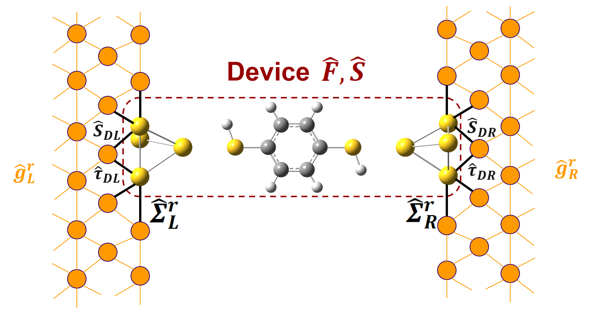

Welcome to gauNEGF's Documentation
==================================

gauNEGF is a Python package for performing Non-Equilibrium Green's Function (NEGF) calculations with the Gaussian python interface.

   The device (dashed box; Fock matrix F, overlap S) couples to
   Bethe-lattice contacts (:math:`g^r_{L,R}`) through :math:`\tau_{DL,DR}`
   and :math:`S_{DL,DR}`, giving the self-energies :math:`\Sigma^r_{L,R}`.

.. note::
   This documentation assumes familiarity with quantum chemistry and DFT concepts. For background theory, see the Theory Guide section.

Getting Started
===============

To get started with gauNEGF:

1. Install the package using pip (see :doc:`installation` for Gaussian and
   gauopen):

   .. code-block:: bash

      pip install -e .

2. Check out the :doc:`examples/index` for practical tutorials
3. Read the :doc:`theory/index` for theoretical background
4. Follow the :doc:`guides/index` for task-oriented setup of contacts, SCF tuning, and workflows
5. Browse the :doc:`api/index` for detailed function documentation

Documentation Contents
======================

.. toctree::
   :maxdepth: 1
   :caption: User Guide

   installation
   quickstart
   supported_configurations

.. toctree::
   :maxdepth: 2
   :caption: Theory Guide

   theory/index

.. toctree::
   :maxdepth: 2
   :caption: Guides

   guides/index

.. toctree::
   :maxdepth: 2
   :caption: Examples

   examples/index

.. toctree::
   :maxdepth: 2
   :caption: API Reference

   api/index

Contributing
============

We welcome contributions! Please see our `Github Repository <https://github.com/wliverno/GauNEGF>`_ for guidelines.

Indices and Tables
==================

* :ref:`genindex`
* :ref:`modindex`
* :ref:`search` 
